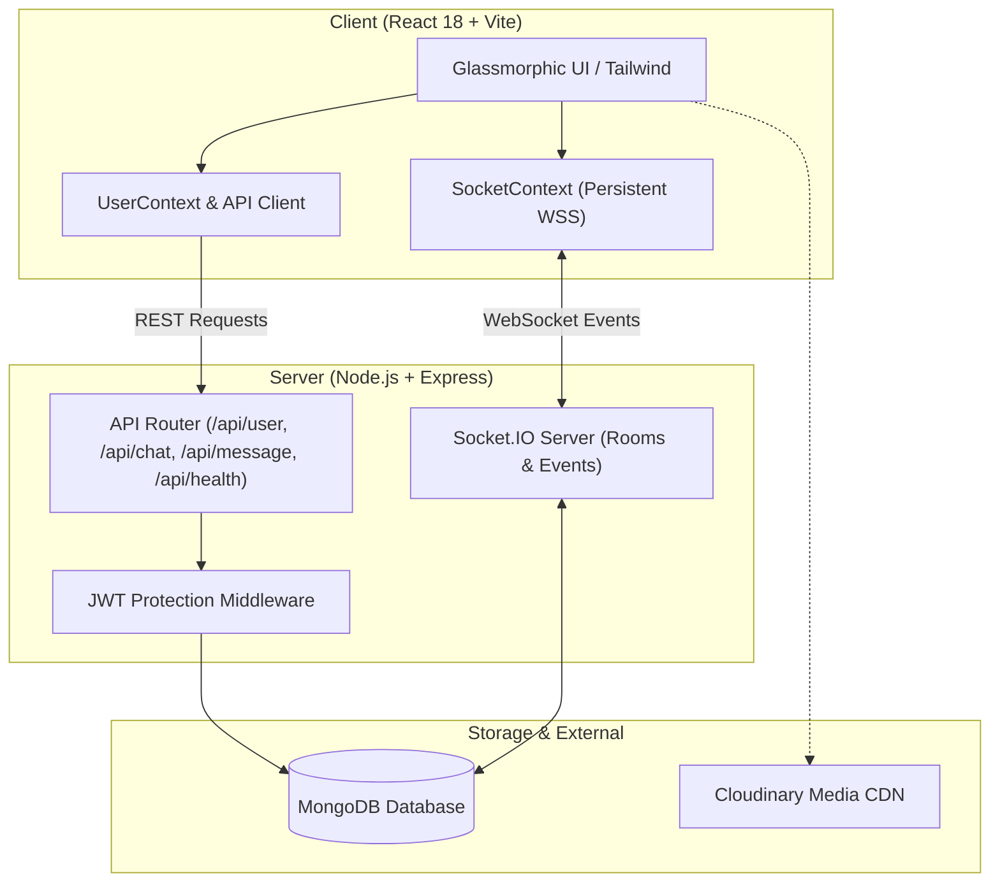

# V-Chat | Real-Time Messaging & Group Channels

[](https://reactjs.org/)
[](https://nodejs.org/)
[](https://expressjs.com/)
[](https://socket.io/)
[](https://www.mongodb.com/)
[](https://tailwindcss.com/)
[](https://vitejs.dev/)
[](https://www.docker.com/)

A modern, high-performance real-time messaging application engineered with the MERN stack (MongoDB, Express, React, Node.js) and Socket.IO. Designed with a sleek, dark-mode glassmorphic user interface, persistent WebSocket session lifecycle management, robust JWT authentication, and full containerization for multi-cloud deployment.

---

## ⚡ Key Highlights & Architecture

- **Low-Latency WebSocket Communications**: Single persistent connection per user session via a dedicated `SocketContext`, eliminating connection leaks and redundant room subscriptions.
- **Direct & Group Channels**: Instant 1-on-1 chats and multi-user group channels with administrator controls (add members, remove members, rename channels).
- **Live Typing & Delivery Indicators**: Real-time typing indicators with animated status bubbles and immediate receipt delivery.
- **Glassmorphic Design System**: Custom Tailwind tokens, frosted-glass backdrops (`backdrop-blur-xl`), subtle radial glow lighting, and mobile-responsive drawer navigation.
- **Enterprise-Grade Security**: Strict credential isolation via environment variables, zero hardcoded secret leakage, bcrypt password hashing, and JWT bearer authentication.
- **Recruiter Demo Mode**: 1-click demo credential filler on the login screen for instant evaluation without registration overhead.
- **Cloud-Ready Containerization**: Multi-stage production `Dockerfile` and `docker-compose.yml` for unified single-command deployment.

---

## 🏗️ System Architecture



---

## 🚀 Quick Start Guide

### Prerequisites
- [Node.js](https://nodejs.org/) (v18 or newer)
- [MongoDB](https://www.mongodb.com/) (Local instance or MongoDB Atlas cluster URI)
- [Docker](https://www.docker.com/) (Optional, for containerized run)

---

### Option A: Running with Docker Compose (Recommended)

Run the complete stack (MongoDB + Backend + Frontend) with one command:

```bash
docker compose up --build
```

Access the app at: **`http://localhost:5000`**

---

### Option B: Local Development

1. **Clone and Install Dependencies**:
   ```bash
   git clone https://github.com/viivek310/chatapp.git
   cd chatapp
   npm install
   npm install --prefix frontend
   ```

2. **Configure Environment Variables**:
   Copy `.env.example` to `.env`:
   ```bash
   cp .env.example .env
   ```
   Configure your MongoDB connection string in `.env`:
   ```env
   PORT=5000
   NODE_ENV=development
   MONGODB_URI=your_mongodb_connection_string
   JWT_SECRET=your_jwt_secret_key
   CLIENT_URL=http://localhost:5173
   ```

3. **Start Development Servers**:
   Run both server and client concurrently:
   ```bash
   npm run dev
   ```

   - **Frontend**: `http://localhost:5173`
   - **Backend API**: `http://localhost:5000`
   - **Health Check**: `http://localhost:5000/api/health`

---

## 🛠️ Environment Variables Reference

| Variable | Scope | Description | Default / Example |
| :--- | :--- | :--- | :--- |
| `PORT` | Backend | HTTP port for Express server | `5000` |
| `NODE_ENV` | Backend | Application environment (`development` / `production`) | `development` |
| `MONGODB_URI` | Backend | MongoDB connection connection string | `mongodb://localhost:27017/vchat` |
| `JWT_SECRET` | Backend | Secret key used to sign and verify JWT tokens | `<strong_random_secret>` |
| `CLIENT_URL` | Backend | Allowed CORS origin for frontend client | `http://localhost:5173` |
| `VITE_BACKEND_API` | Frontend | Target API server URL in development | `http://localhost:5000/` |
| `VITE_CLOUDINARY_CLOUD_NAME` | Frontend | Cloudinary cloud name for profile photo uploads (optional) | `your_cloud_name` |

---

## 📡 REST API Specification

### Authentication & Users
- `POST /api/user` — Register a new account (`name`, `email`, `password`, optional `pic`).
- `POST /api/user/login` — Authenticate user and receive signed JWT.
- `GET /api/user?search=:query` — Search users by name or email (Protected).
- `POST /api/user/update` — Update user profile information (Protected).

### Channels & Chats
- `POST /api/chat` — Access or create a 1-on-1 direct channel (Protected).
- `GET /api/chat` — Retrieve all active conversations for current user (Protected).
- `POST /api/chat/group` — Create a new group channel (Protected).
- `PUT /api/chat/rename` — Rename group channel (Protected).
- `PUT /api/chat/groupadd` — Add a participant to group (Admin only, Protected).
- `PUT /api/chat/groupremove` — Remove a participant or leave group (Protected).

### Messages
- `POST /api/message` — Send a message in a channel (Protected).
- `GET /api/message/:chatId` — Fetch all messages in a channel (Protected).

### System & Health
- `GET /api/health` — Platform health check (`status`, `uptime`, `timestamp`, `environment`).

---

## 🔒 Security & Sanitization

- **Credential Hygiene**: All private API keys and Firebase service credentials have been completely eradicated from Git history and decoupled from runtime.
- **Network Isolation**: The MongoDB container in Docker is bound exclusively to an internal Docker bridge network (`vchat-network`) with no host ports exposed externally.
- **Sanitized Payloads**: Passwords are excluded from user query projections (`.select("-password")`).
- **Injection Protection**: Queries utilize parameterized Mongoose models with regex escaping on user search inputs.

---

## 📄 License
This project is licensed under the MIT License — open for educational, personal, and portfolio use.
